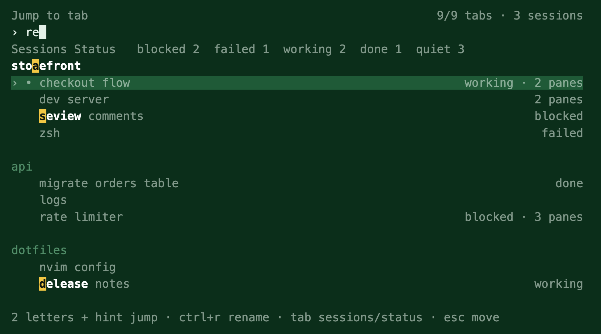
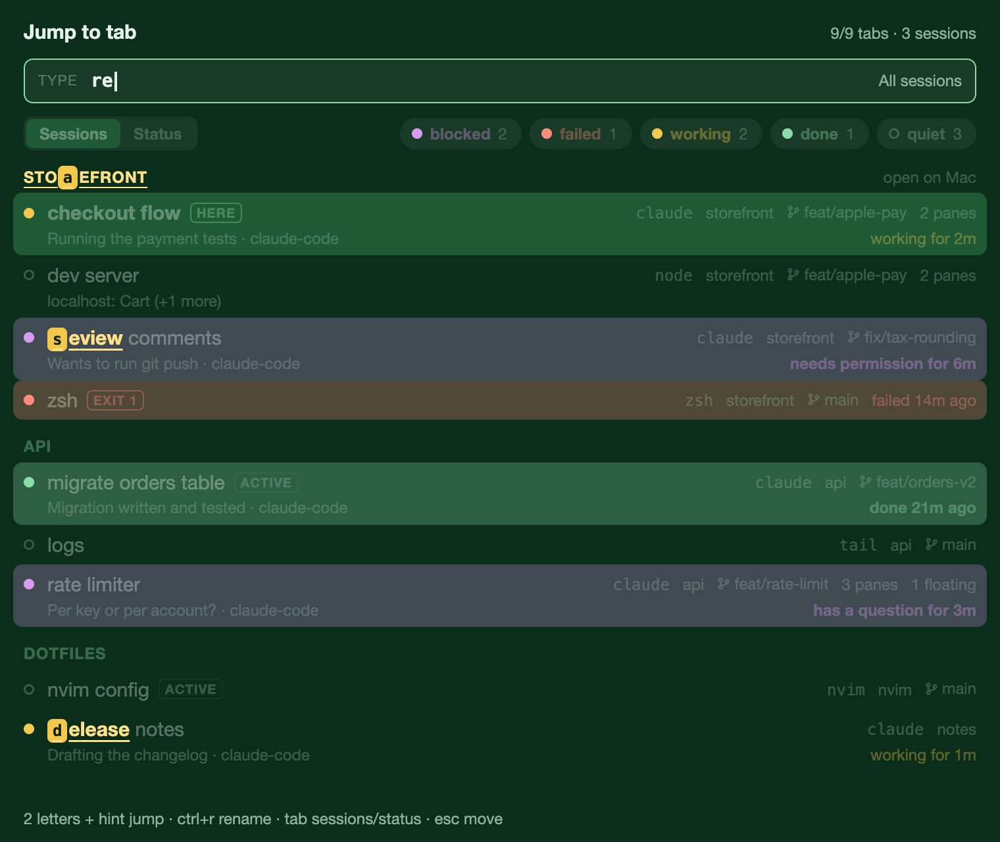

# rex-tabjump

A tab jumper for [Rex](https://www.superlogical.com/rex). Press Cmd+O and a
floating panel lists every tab in every session. Type two characters of a
tab's name, then the hint that appears on it, and you are there. It works the
way hop.nvim does.



Here `re` has been typed, and each word that contains it shows a hint. There
is also [a web version](#the-web-panel) that shows more about each tab.

You can also rename tabs from the list without visiting them.

## Requirements

- Rex, with the `rex` command on your PATH.
- Node.js 22.18 or later. The panels are TypeScript that Node runs directly.
- Optional: rexweb, for the [web version of the panel](#the-web-panel). The
  terminal panel doesn't need it. tabjump is built and tested against
  [my fork of rexweb](https://github.com/JaredVogt/rexweb), which adds to
  [the original](https://github.com/acoyfellow/rexweb).

## Install

```sh
git clone https://github.com/JaredVogt/rex-tabjump.git
cd rex-tabjump
./install.sh
```

The script links the folder into Rex's config folder as `tabjump`. Then add
this line to `~/.config/rex/init.lua` and run `rex config reload`:

```lua
require("tabjump").setup{}
```

To remove it, run `./install.sh --uninstall` and take that line out again.

## Using it

The panel opens in type mode, with the selection on the tab you are in.

| Key | Type mode | Move mode |
|---|---|---|
| Two letters, then the hint | Jump to that tab | Select that tab |
| Up, Down, Ctrl+P, Ctrl+N | Move the selection | Move the selection |
| `j`, `k` | Search letters | Move the selection, while nothing is typed |
| Enter | Jump to the selected tab | Jump to the selected tab |
| Ctrl+R | Rename the selected tab | Rename the selected tab |
| Tab | Group by session or by status | The same |
| Backspace | Undo a letter, then a filter | The same |
| Esc | Go to move mode | Drop a search, then close |

The two letters can be anywhere inside a word, not only at its start. If just
one word on screen matches, there is no hint to type.

Session names and the status words above the list take hints too. Picking a
session shows only its tabs; picking a status shows only tabs in that state.

### Renaming

Ctrl+R asks for a name for the selected tab. Enter saves it, Esc cancels and
Ctrl+U clears the line. The panel stays open, so you can rename several tabs.

A name you gave earlier is there to edit. Saving an empty name gives the tab
back the title it would have on its own.

## Options

All are optional. These are the defaults:

```lua
require("tabjump").setup{
  key = "cmd+o",       -- open the panel; false for no shortcut
  node = nil,          -- the node to run the panels with; looked for by default
  columns = 84,        -- the panel's width in characters
  left = 0.25,         -- its left edge, as a fraction of the window's width
  top = 0.12,          -- its top edge, as a fraction of the window's height
  height = 0.7,        -- its height, as a fraction of the window's height
  font_bump = 4,       -- font size steps above your terminal font; 0 for none
  web_key = "cmd+j",   -- open the web panel; false for no shortcut
  web_width = 900,     -- the web panel's width in pixels; 1 or less is a fraction of the window
  rexweb = "~/Applications/RexWeb.app",
  dir = nil,           -- the folder holding tabjump.ts; found by default
  rex = nil,           -- the rex command, for tabs on other hosts; looked for by default
}
```

Without `node`, tabjump uses the first of `/opt/homebrew/bin/node`,
`/usr/local/bin/node`, `~/.local/bin/node` and `/usr/bin/node` that exists,
and otherwise the `node` on the pane's PATH.

## Other hosts

Tabs on the hosts that `rex hosts` lists are in the panel too, under their
session's name followed by `@` and the host. A host takes a couple of
seconds to answer, so its tabs join the list shortly after the panel opens,
and jumping to one takes as long again.

The panel always runs on this machine. Opened from a tab on another host, it
appears in one of this machine's sessions, and closing it without a jump
takes you back to the tab you were on. Tabs on another host show no git
branch.

## The web panel

With [rexweb](https://github.com/JaredVogt/rexweb) installed, Cmd+J opens the
same panel drawn as a web page, with more about each tab: its folder, git
branch, and what its program last said. Restyle it by editing `panel.html`.



Here `re` has been typed, and each word that contains it shows a hint.

The default Cmd+J shortcut is bound only when RexWeb is found. The "Jump to
Tab (Web)" action is always there, and says so if RexWeb is missing.

For a background picture, put a file named `background.gif` (or `.png`,
`.jpg`, `.webp`) in this folder.

## Development

```sh
pnpm install
pnpm test        # the selection logic, in hop.test.ts
pnpm typecheck
```

- `hop.ts` holds all the behaviour: modes, matching, hints, renaming. It is
  pure, and both panels share it.
- `tabs.ts` reads the tabs from Rex and carries out a jump or a rename.
- `tabjump.ts` is the terminal panel; `tabjump-web.ts` and `panel.html` are
  the web panel.
- `init.lua` registers the two actions and their shortcuts.

`node tabjump.ts --list` prints the tab list without opening the panel.

## License

MIT. See [LICENSE](LICENSE).
